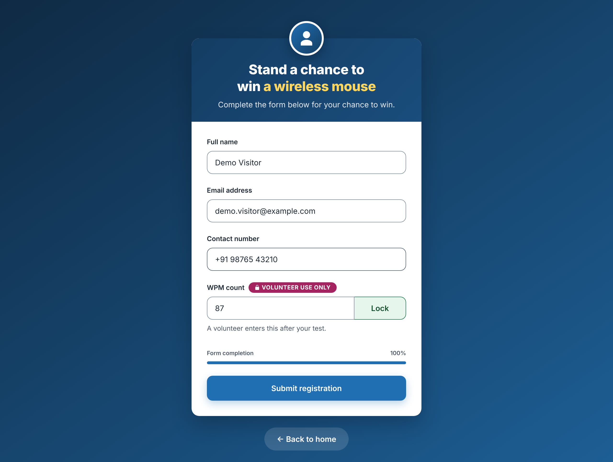
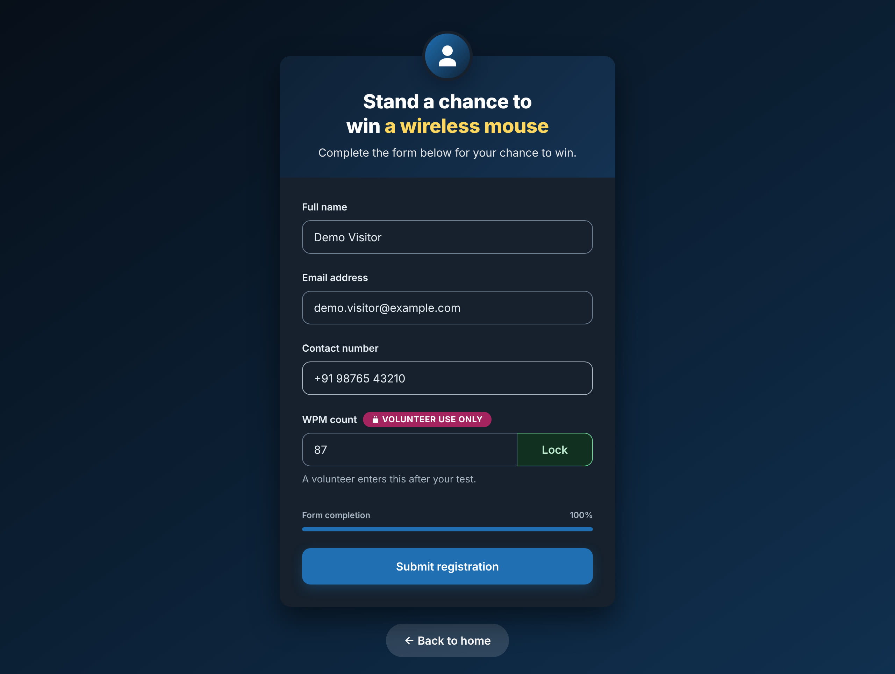
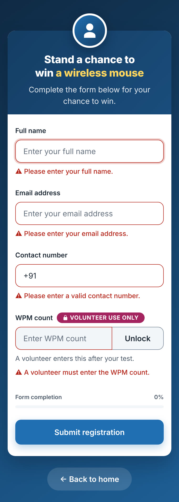
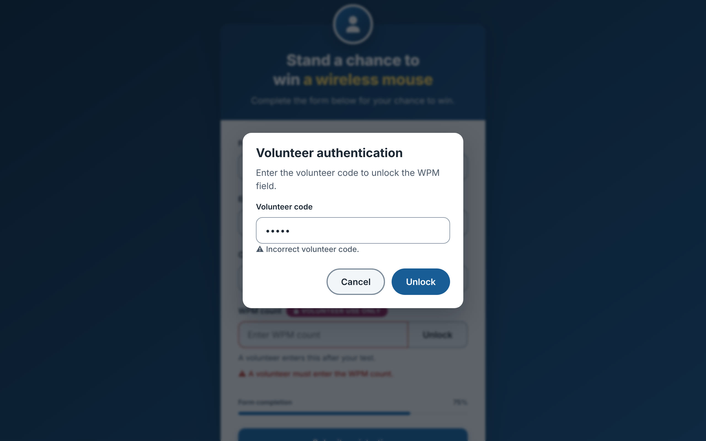
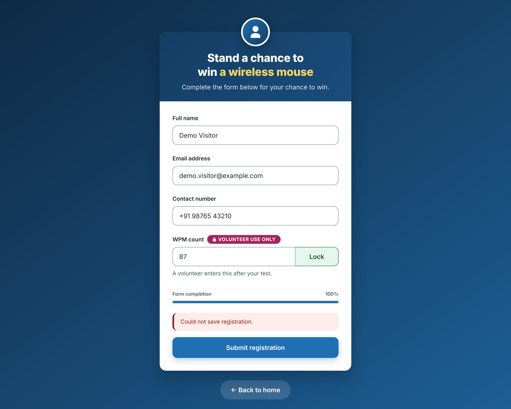
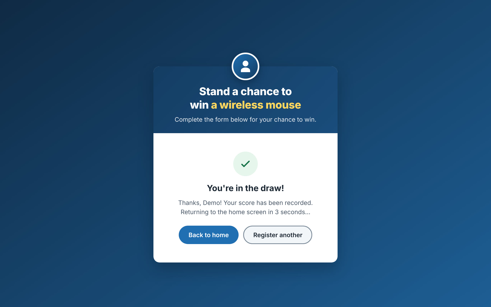
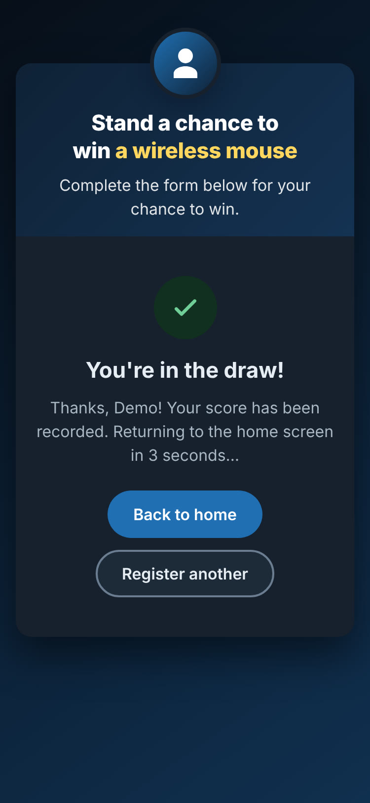
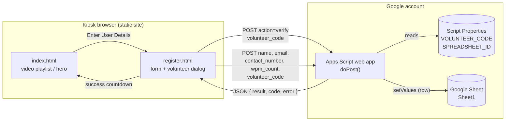
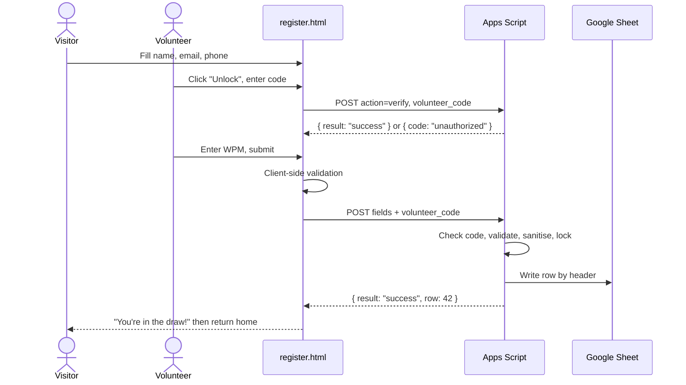

# Typing Test Giveaway Kiosk


**A two-screen web kiosk for running a typing-speed giveaway at an event booth: visitors register,
volunteers record their WPM score, and every entry lands in a Google Sheet.**

> **Independent project.** This repository is not affiliated with, sponsored by, or endorsed by
> any hardware manufacturer or brand. Any product name you put in your own configuration (for
> example, the prize) is used only to describe your giveaway.

---

## Table of contents

- [Overview](#overview)
- [Screenshots](#screenshots)
- [Features](#features)
- [Tech stack](#tech-stack)
- [Architecture](#architecture)
- [Project structure](#project-structure)
- [Getting started](#getting-started)
- [Configuration](#configuration)
- [Usage](#usage)
- [API reference](#api-reference)
- [Scripts](#scripts)
- [Testing](#testing)
- [Linting and formatting](#linting-and-formatting)
- [Deployment](#deployment)
- [Troubleshooting and FAQ](#troubleshooting-and-faq)
- [Security and privacy](#security-and-privacy)
- [Known limitations](#known-limitations)
- [Roadmap ideas](#roadmap-ideas)
- [Contributing](#contributing)
- [License](#license)

## Overview

At a booth where people take a typing test to win a prize, you need a quick way to collect each
participant's details and their **verified** score. A paper sheet is slow and easy to tamper with,
and a generic form lets anyone type in any score.

This kiosk solves that with:

1. An attract screen (looping background video or a gradient hero) with a single big
   **Enter User Details** button.
2. A registration form where the visitor fills in their name, email and phone number.
3. A **volunteer-only WPM field** that stays locked until a volunteer enters a code. The code is
   checked by the backend, not the browser, so visitors can't unlock it from DevTools.
4. A Google Apps Script backend that validates the entry and appends it to a Google Sheet, which
   organisers can sort to find the winner.

It's built for event organisers, student clubs and community groups who want something they can
deploy for free (static hosting plus Google Sheets) in under 15 minutes.

## Screenshots

All screenshots were captured from the running app with demo data. The home screen is shown with
the gradient fallback because no background video ships with the repository.

| Home screen (desktop)                                        | Home screen (phone)                                      |
| ------------------------------------------------------------ | -------------------------------------------------------- |
|  |  |

| Completed form (light)                                                    | Completed form (dark mode)                                                     |
| ------------------------------------------------------------------------- | ------------------------------------------------------------------------------ |
|  |  |

| Inline validation (phone)                                                 | Volunteer unlock dialog                                                 |
| ------------------------------------------------------------------------- | ----------------------------------------------------------------------- |
|  |  |

| Server error state                                                          | Success state                                                          | Success (phone, dark)                                                              |
| --------------------------------------------------------------------------- | ---------------------------------------------------------------------- | ---------------------------------------------------------------------------------- |
|  |  |  |

<details>
<summary>404 page</summary>


</details>

## Features

**Kiosk home screen**

- A full-screen, muted, autoplaying **video playlist** that loops, skips files that fail to load,
  and fades in once playback starts.
- A **gradient hero fallback** ("How fast can you type?") when no video is configured or none can
  play.
- **Kiosk mode:** press <kbd>L</kbd> to hide or show the buttons so the video plays unobstructed.
  The hint is hidden on touch-only devices.
- An optional secondary **"learn more" button** linking to any URL you configure.

**Registration form**

- Name, email, contact number and WPM fields with **friendly inline validation**. Errors appear when
  you leave a filled-in field and on submit, clear as you type, and are announced to screen readers.
- The contact number keeps a fixed **`+91 ` prefix** through typing, backspace, cut and paste.
  Pasted numbers are inserted at the caret, and a pasted country code isn't doubled.
- A live **completion progress bar** with a percentage.
- **Loading spinners** on async buttons, a **server/network error banner** that keeps the form
  data so the visitor can retry, and a **success panel** with a countdown back to the home screen
  plus a **Register another** shortcut.
- A **configuration warning** and disabled submit button when the backend URL isn't set.

**Volunteer verification**

- The WPM field unlocks only after the volunteer enters a code in an accessible modal
  `<dialog>`.
- The code is verified by the backend (`action=verify`) and **re-verified on every submission**.
  It's kept only in page memory and is never written to the sheet.

**Backend (Google Apps Script)**

- Columns are matched by the sheet's **header row**, so you can reorder or add columns freely.
- **Server-side validation** mirrors the client rules (a malicious POST can't bypass them).
- **Formula-injection protection:** values starting with `=`, `+`, `-` or `@` are stored as text.
- Writes are serialised with `LockService`, and structured JSON errors (`unauthorized`, `invalid`,
  `busy`, `server`) are returned.

**Quality and UX**

- A design-token system (spacing, type scale, palette) with **automatic dark mode** via
  `prefers-color-scheme`.
- **WCAG AA contrast**, visible focus rings, labelled controls, logical tab order, touch targets
  of at least 44px, and `prefers-reduced-motion` support. Every page scans clean with axe-core.
- Responsive layouts verified at 375px (phone), 768px (tablet) and 1280px (desktop).
- Page titles, meta descriptions, Open Graph and Twitter card tags, an SVG favicon and a 404
  page.
- No runtime dependencies: about 3 KB of gzipped JS per page.

## Tech stack

| Layer      | Technology                                                              | Notes                                              |
| ---------- | ----------------------------------------------------------------------- | -------------------------------------------------- |
| Frontend   | Vanilla HTML, CSS and JavaScript (ES modules)                           | No framework, no runtime dependencies              |
| Build      | [Vite 8](https://vite.dev/)                                             | Multi-page build, `VITE_*` env-var injection       |
| Backend    | [Google Apps Script](https://developers.google.com/apps-script) web app | V8 runtime, `doPost` endpoint                      |
| Storage    | Google Sheets                                                           | One row per registration                           |
| Testing    | [Vitest](https://vitest.dev/)                                           | Unit tests incl. the Apps Script code in a sandbox |
| Linting    | ESLint 9 (flat config)                                                  | Lints both `src/` and `apps-script/Code.gs`        |
| Formatting | Prettier 3                                                              |                                                    |

## Architecture



**Request flow for one registration**



Key design decisions:

- **No secrets in the browser.** Everything in `VITE_*` is public. The volunteer code lives only
  in Apps Script properties.
- **Pure logic is separated from the DOM** (`src/lib/*`), which keeps it unit-testable. The same
  applies to the Apps Script file, whose pure helpers are tested in a Node `vm` sandbox.
- **Fully static frontend**, so it can be hosted anywhere or run from a laptop at the booth.

## Project structure

```
.
├── index.html                 # Kiosk home screen (video background / gradient hero)
├── register.html              # Registration form, success panel, volunteer <dialog>
├── 404.html                   # Not-found page (served by static hosts for unknown paths)
├── src/
│   ├── home.js                # Home: playlist wiring, fade-in, "L" kiosk toggle
│   ├── register.js            # Form: validation UI, phone prefix, volunteer lock, submit, success
│   ├── lib/                   # Framework-free, unit-tested modules
│   │   ├── api.js             #   Apps Script client: FormData POST, timeout, typed ApiError
│   │   ├── config.js          #   Reads VITE_* env vars and applies defaults
│   │   ├── particles.js       #   Decorative canvas animation (off for reduced motion)
│   │   ├── phone.js           #   Country-code prefix: normalise, guard deletes, paste at caret
│   │   ├── playlist.js        #   Cyclic playlist that skips broken entries
│   │   ├── progress.js        #   Form completion percentage
│   │   └── validation.js      #   Field validators (mirrors the server rules)
│   └── styles/
│       ├── base.css           # Design tokens, light/dark palette, buttons, focus, motion
│       ├── home.css           # Home screen (imports base.css)
│       ├── register.css       # Form, dialog, states (imports base.css)
│       └── not-found.css      # 404 page (imports base.css)
├── apps-script/
│   ├── Code.gs                # Backend: doPost, validation, sanitising, locking
│   └── appsscript.json        # Manifest: V8 runtime, web app access settings
├── public/                    # Copied verbatim into dist/
│   ├── favicon.svg
│   ├── og-image.jpg           # Social preview image (1200×630)
│   └── videos/                # Your background videos (git-ignored except README)
├── tests/                     # Vitest unit tests
├── docs/screenshots/          # Screenshots used in this README
├── .env.example               # Every supported env var, documented
├── eslint.config.js
├── vite.config.js             # Multi-page inputs, appType "mpa", test config
└── package.json
```

## Getting started

### Prerequisites

- **Node.js 20.19+** (22 LTS recommended; `.nvmrc` is provided) and npm.
- A **Google account** for the Sheet and Apps Script. This is only needed to actually save
  submissions; the UI runs without it.

### 1. Clone and install

```bash
git clone https://github.com/jeevithg090/LogitechTypingTest.git
cd LogitechTypingTest
npm install
```

### 2. Create the Google Sheet

Create a new Google Sheet. Rename the first tab to **`Sheet1`** (or change `SHEET_NAME` in
`Code.gs`) and add this header row:

| timestamp | name | email | contact_number | wpm_count |
| --------- | ---- | ----- | -------------- | --------- |

You can reorder these columns or add extra ones. Any header that doesn't match a form field is
left blank.

### 3. Deploy the Apps Script backend

1. In the sheet, open **Extensions → Apps Script**.
2. Replace the contents of `Code.gs` with [`apps-script/Code.gs`](apps-script/Code.gs).
3. (Optional) Enable **Project Settings → Show "appsscript.json" manifest file** and paste
   [`apps-script/appsscript.json`](apps-script/appsscript.json).
4. Select the `initialSetup` function and click **Run**. Approve the permission prompt. This
   stores the spreadsheet ID in the `SPREADSHEET_ID` script property.
5. Open **Project Settings → Script properties → Add script property**:
   - Property: `VOLUNTEER_CODE`
   - Value: a long, hard-to-guess code. Share it only with volunteers.
6. Click **Deploy → New deployment**, choose type **Web app**, set _Execute as_ to **Me** and
   _Who has access_ to **Anyone**, then click **Deploy**.
7. Copy the **Web app URL** (it ends in `/exec`).

> Whenever you change `Code.gs`, use **Deploy → Manage deployments → Edit → New version**.
> Otherwise the old code keeps running.

### 4. Configure and run

```bash
cp .env.example .env.local
# edit .env.local and set VITE_SCRIPT_URL to your /exec URL
npm run dev
```

Open <http://localhost:5173>. For a production build:

```bash
npm run build     # outputs to dist/
npm run preview   # serves dist/ at http://localhost:4173
```

### 5. (Optional) Add background videos

Copy MP4 files you have the rights to use into `public/videos/` and list them in
`VITE_BACKGROUND_VIDEOS`, for example `/videos/intro.mp4,/videos/demo.mp4`. Keep each file small
(1080p H.264 at a modest bitrate) for fast loading on booth Wi-Fi.

## Configuration

### Frontend environment variables

Read by Vite **at build time** from `.env`, `.env.local` or the host's build settings. They are
embedded in the public JavaScript, so **never put secrets here**.

| Variable                 | Required | Default            | Description                                                                                             |
| ------------------------ | -------- | ------------------ | ------------------------------------------------------------------------------------------------------- |
| `VITE_SCRIPT_URL`        | Yes\*    | _(empty)_          | Apps Script web app URL ending in `/exec`. \*Without it, submission is disabled and a warning is shown. |
| `VITE_PRIZE_NAME`        | No       | `a wireless mouse` | Completes the heading "Stand a chance to win …".                                                        |
| `VITE_LEARN_MORE_URL`    | No       | _(empty)_          | Adds a secondary home-screen button linking here (opens in a new tab).                                  |
| `VITE_LEARN_MORE_LABEL`  | No       | `Learn more`       | Label for that button.                                                                                  |
| `VITE_BACKGROUND_VIDEOS` | No       | _(empty)_          | Comma-separated video paths served from `public/`. Empty = gradient hero.                               |
| `VITE_REDIRECT_SECONDS`  | No       | `5`                | Seconds before the success screen returns to the home screen.                                           |

### Backend script properties

Set in **Apps Script → Project Settings → Script properties**. These stay on Google's servers.

| Property         | Required | Description                                                           |
| ---------------- | -------- | --------------------------------------------------------------------- |
| `VOLUNTEER_CODE` | Yes      | Secret code that unlocks the WPM field. All requests fail without it. |
| `SPREADSHEET_ID` | Yes      | Set automatically by running `initialSetup()` once.                   |

Constants at the top of `Code.gs`: `SHEET_NAME` (default `Sheet1`), `MAX_WPM` (default `300`;
keep it in sync with `MAX_WPM` in `src/lib/validation.js`) and `LOCK_TIMEOUT_MS`.

## Usage

### Booth walkthrough

1. Open the deployed site full-screen on the kiosk. On Chrome you can start it with
   `--kiosk https://your-site/`.
2. The visitor taps **Enter User Details** and fills in their name, email and phone number.
3. After the typing test, a volunteer taps **Unlock** and enters the volunteer code. If the code
   is wrong, an error appears in the dialog.
4. The volunteer types the WPM score and taps **Submit registration**.
5. The visitor sees **"You're in the draw!"**, and the kiosk returns to the home screen after the
   countdown. Tap **Register another** to skip the countdown.
6. To pick a winner, sort the sheet by `wpm_count`.

### Keyboard shortcuts

| Key                                              | Where       | Action                                |
| ------------------------------------------------ | ----------- | ------------------------------------- |
| <kbd>L</kbd>                                     | Home screen | Toggle the buttons (clean video mode) |
| <kbd>Esc</kbd>                                   | Dialog      | Close the volunteer dialog            |
| <kbd>Tab</kbd> / <kbd>Shift</kbd>+<kbd>Tab</kbd> | Everywhere  | Move between fields and buttons       |

## API reference

The backend is a single Google Apps Script web app endpoint. Requests are
`application/x-www-form-urlencoded` or `multipart/form-data` POSTs. Apps Script answers with a
302 redirect to the JSON result (browsers follow it automatically; with curl use `-L`).

| Method | Path                                               | Auth                   | Description                                 |
| ------ | -------------------------------------------------- | ---------------------- | ------------------------------------------- |
| POST   | `/macros/s/<deployment>/exec` with `action=verify` | `volunteer_code` field | Checks a volunteer code. Writes nothing.    |
| POST   | `/macros/s/<deployment>/exec`                      | `volunteer_code` field | Validates and appends one registration row. |

**Request fields**

| Field            | Required for | Rules                                       |
| ---------------- | ------------ | ------------------------------------------- |
| `volunteer_code` | all requests | Must equal the `VOLUNTEER_CODE` property    |
| `action`         | verify only  | `verify`                                    |
| `name`           | registration | 2–100 characters                            |
| `email`          | registration | Valid email, ≤ 254 characters               |
| `contact_number` | registration | 7–15 digits (formatting characters ignored) |
| `wpm_count`      | registration | Whole number 0–300                          |

**Example: verify a code**

```bash
curl -sL "$VITE_SCRIPT_URL" \
  --data-urlencode "action=verify" \
  --data-urlencode "volunteer_code=correct-horse-battery"
```

```json
{ "result": "success" }
```

**Example: submit a registration**

```bash
curl -sL "$VITE_SCRIPT_URL" \
  --data-urlencode "name=Demo Visitor" \
  --data-urlencode "email=demo.visitor@example.com" \
  --data-urlencode "contact_number=+91 98765 43210" \
  --data-urlencode "wpm_count=87" \
  --data-urlencode "volunteer_code=correct-horse-battery"
```

```json
{ "result": "success", "row": 42 }
```

**Error responses** (always HTTP 200 with `result: "error"`, which is an Apps Script limitation):

| `code`         | Meaning                                                      | Example `error` text            |
| -------------- | ------------------------------------------------------------ | ------------------------------- |
| `unauthorized` | Missing or wrong volunteer code, or `VOLUNTEER_CODE` not set | `Invalid volunteer code.`       |
| `invalid`      | Field validation failed                                      | `Email address is invalid.`     |
| `busy`         | Couldn't acquire the script lock within 10s                  | `Server is busy. Please retry.` |
| `server`       | Unexpected failure (e.g. missing sheet)                      | `Could not save registration.`  |

## Scripts

| Command                | Description                                         |
| ---------------------- | --------------------------------------------------- |
| `npm run dev`          | Start the Vite dev server with hot reload           |
| `npm run build`        | Production build to `dist/`                         |
| `npm run preview`      | Serve the production build locally                  |
| `npm test`             | Run all unit tests once                             |
| `npm run test:watch`   | Run tests in watch mode                             |
| `npm run lint`         | ESLint over `src/`, `tests/`, configs and `Code.gs` |
| `npm run format`       | Format all files with Prettier                      |
| `npm run format:check` | Fail if any file isn't formatted                    |
| `npm run check`        | Lint, format check, tests and build in one go       |

## Testing

```bash
npm test
```

There are 38 unit tests in `tests/`:

| File                        | Covers                                                                                                                                                                                                                                                    |
| --------------------------- | --------------------------------------------------------------------------------------------------------------------------------------------------------------------------------------------------------------------------------------------------------- |
| `validation.test.js`        | Every field rule, edge cases (bare `+91 `, `1e3`, decimals, max WPM)                                                                                                                                                                                      |
| `phone.test.js`             | Prefix normalisation, backspace/delete guards, paste at caret, no duplicate country code                                                                                                                                                                  |
| `progress-playlist.test.js` | Completion percentage, playlist cycling and skipping broken videos                                                                                                                                                                                        |
| `api.test.js`               | FormData POST, config/network/HTTP/parse/timeout errors, server error codes                                                                                                                                                                               |
| `apps-script.test.js`       | Loads `Code.gs` in a Node `vm` sandbox with fake `SpreadsheetApp`, `LockService`, `PropertiesService` and `ContentService`: volunteer-code enforcement, verify action, validation, formula-injection sanitising, private fields not stored, lock handling |

The UI flows (navigation, validation messages, unlock dialog, error and success states, keyboard
navigation, responsive layout at 375/768/1280px in light and dark mode, and axe-core
accessibility scans) were verified manually with Playwright against a production build.

## Linting and formatting

- **ESLint 9** with `@eslint/js` recommended rules. Browser globals apply to `src/`, Node globals
  to tests and configs, and `Code.gs` is linted as a classic script with Apps Script globals.
- **Prettier 3** (single quotes, 100-column width, trailing commas). `.editorconfig` keeps editors
  consistent.

Run `npm run check` before committing.

## Deployment

The frontend is a fully static site. Build it with the right env vars, then upload `dist/`.

| Host                 | Build command   | Output dir | Env vars                                   | 404 handling                               |
| -------------------- | --------------- | ---------- | ------------------------------------------ | ------------------------------------------ |
| **Netlify**          | `npm run build` | `dist`     | Site settings → Environment variables      | Serves `404.html` automatically            |
| **Vercel**           | `npm run build` | `dist`     | Project → Settings → Environment Variables | Serves `404.html` automatically            |
| **Cloudflare Pages** | `npm run build` | `dist`     | Settings → Environment variables           | Serves `404.html` automatically            |
| **GitHub Pages**     | `npm run build` | `dist`     | Use a local `.env.local` or a build step   | Serves `404.html` automatically            |
| **Booth laptop**     | `npm run build` | `dist`     | `.env.local`                               | Run `npm run preview` or any static server |

Notes:

- Asset URLs are absolute (`/…`), so deploy at the **root of a domain**. For a sub-path (e.g.
  GitHub project pages), set `base` in `vite.config.js` and update the `/` links in the HTML.
- Videos must be in `public/videos/` **before** building so they're copied into `dist/videos/`.
- `og:image` is a relative path. For rich link previews on social networks, change it to an
  absolute URL once you know your domain.
- Browsers only autoplay **muted** video, which is how the player is configured.

## Troubleshooting and FAQ

<details>
<summary><strong>The form says "Submissions are not configured".</strong></summary>

`VITE_SCRIPT_URL` was empty **at build time**. Set it in `.env.local` (dev) or in your host's
environment settings, then rebuild or restart `npm run dev`. Vite reads env vars only on startup.

</details>

<details>
<summary><strong>Unlock always says "Incorrect volunteer code".</strong></summary>

- Check that the `VOLUNTEER_CODE` script property exists. The backend rejects every request when
  it's missing.
- Codes are case-sensitive. Leading and trailing spaces are ignored.
- Make sure you deployed a **new version** after pasting the new `Code.gs`.

</details>

<details>
<summary><strong>"Network error" or "Unexpected response from the server".</strong></summary>

- The URL must be the **/exec** URL (not `/dev`, and not the editor URL).
- The deployment must have _Who has access_ set to **Anyone**. Otherwise Google returns a login
  page (HTML), which the client reports as an unexpected response.
- Corporate or event Wi-Fi may block `script.google.com`. Try a mobile hotspot.

</details>

<details>
<summary><strong>"Could not save registration."</strong></summary>

The script couldn't open the sheet. Run `initialSetup` again, check that the tab is named
`Sheet1` (or update `SHEET_NAME`), and look at **Apps Script → Executions** for the logged error.

</details>

<details>
<summary><strong>The background video doesn't play.</strong></summary>

Check that the paths in `VITE_BACKGROUND_VIDEOS` match files in `public/videos/` (and that you
rebuilt). Broken entries are skipped automatically. If all of them fail, the gradient hero is
shown. Use H.264 MP4 for the widest browser support.

</details>

<details>
<summary><strong>Phone numbers show an apostrophe in the sheet.</strong></summary>

They don't: the leading `'` tells Google Sheets to store `+91 …` as text instead of evaluating
it as a formula. It's hidden in the cell and only visible in the formula bar.

</details>

<details>
<summary><strong>How do I change the country code?</strong></summary>

Change `DEFAULT_PREFIX` in `src/lib/phone.js` and the `value="+91 "` attribute on
`#contact_number` in `register.html`.

</details>

<details>
<summary><strong>How do I force light or dark mode?</strong></summary>

The theme follows the operating system. To force one, set `color-scheme: light` (or `dark`) on
`:root` in `src/styles/base.css` and remove the `@media (prefers-color-scheme: dark)` block (or
make it unconditional).

</details>

## Security and privacy

- **Keep `VOLUNTEER_CODE` out of the repo** and rotate it for each event. Anything prefixed
  `VITE_` is public.
- The Apps Script endpoint is publicly reachable by design (an anonymous kiosk). The volunteer
  code gates every write, but **the endpoint isn't rate-limited**, so use a long code.
- The sheet contains **personal data** (names, emails, phone numbers). Restrict sharing, tell
  participants how their data will be used, and delete it when the giveaway ends.
- Spreadsheet formula injection is neutralised server-side.

## Known limitations

- **No rate limiting** on the Apps Script endpoint, so the volunteer code could in theory be
  brute-forced. Mitigate with a long code that you rotate per event.
- **No duplicate detection:** the same person can register more than once.
- Apps Script always responds with **HTTP 200**, so errors are signalled in the JSON body only.
- The contact number field assumes a single fixed country code (`+91`).
- The UI is English-only.
- No offline queue: if the booth loses connectivity, the submission fails (with a clear error)
  and must be retried.
- There are no end-to-end tests in the repo. UI flows were verified manually with Playwright.

## Roadmap ideas

- Rate limiting and lockout in Apps Script (e.g. `CacheService` counters per code attempt).
- Duplicate-entry detection by email or phone.
- A built-in typing test that fills in the WPM automatically, so volunteers only confirm it.
- A live leaderboard page fed from the sheet.
- An offline submission queue (IndexedDB) with retry when back online.
- Configurable country code and i18n.
- A committed Playwright end-to-end suite.

## Contributing

Contributions are welcome.

1. Fork the repo and create a branch: `git checkout -b feat/my-change`.
2. Install with `npm install`, make your change, and add or adjust tests in `tests/`.
3. Run `npm run check` (lint, format, tests, build); it must pass.
4. Use [Conventional Commits](https://www.conventionalcommits.org/) (`feat:`, `fix:`, `docs:` …).
5. Open a pull request describing the change and how you tested it. Include screenshots for UI
   changes.

If you change validation rules, update **both** `src/lib/validation.js` and
`apps-script/Code.gs`, plus their tests.

## License

No license file has been added yet, so by default all rights are reserved by the author. If you
intend others to reuse this project, adding a permissive license such as
[MIT](https://choosealicense.com/licenses/mit/) is recommended.
